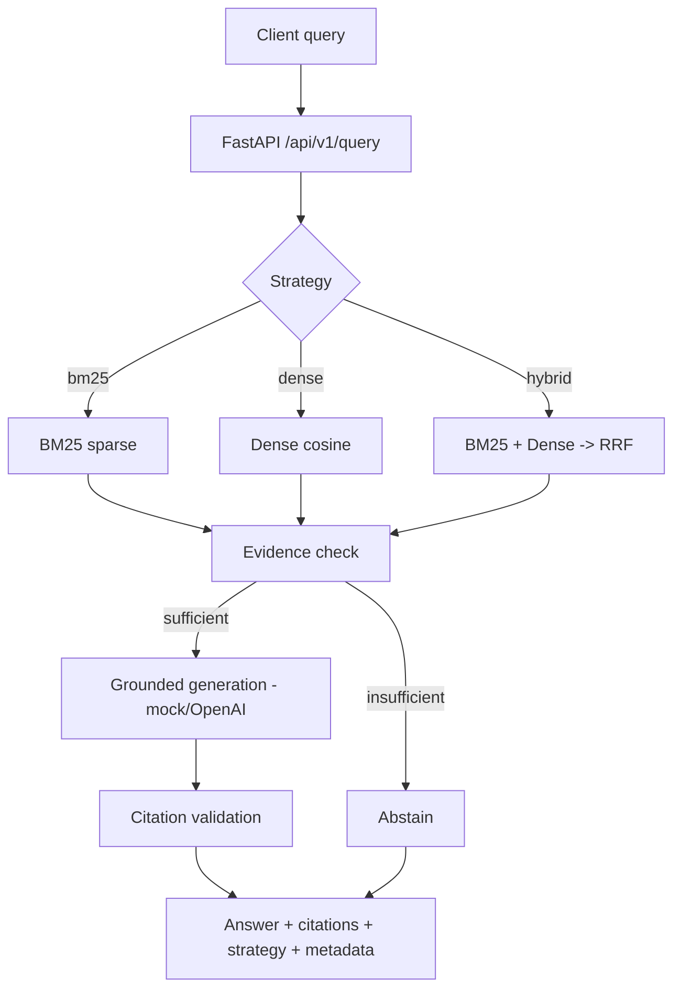
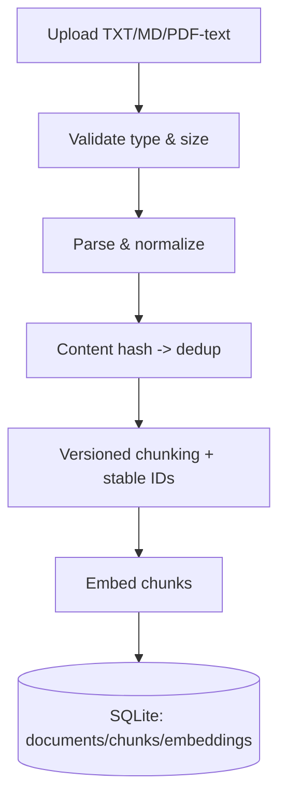

# Architecture

This describes the **implemented** components only. Planned/optional components
are labeled.

## Components

| Module | Responsibility |
|---|---|
| `ragbench/config.py` | Env-driven config; derives `index_version`. |
| `ragbench/ingestion/` | Parsing/normalization, versioned chunking, stable IDs. |
| `ragbench/embeddings/` | Embedding Protocol + deterministic fake provider. |
| `ragbench/storage/` | SQLite persistence (documents/chunks/embeddings). |
| `ragbench/retrieval/` | BM25, dense cosine, RRF fusion, hybrid orchestrator. |
| `ragbench/generation/` | Generation Protocol, mock provider, citation validation. |
| `ragbench/reranking/` | Reranker interface + deterministic heuristic stand-in. |
| `ragbench/routing/` | Interpretable query-aware router with hybrid fallback. |
| `ragbench/evaluation/` | Ranking metrics + reproducible baseline harness (B0–B4) + ablation. |
| `ragbench/pipeline.py` | Online query path + ingestion path orchestration. |
| `ragbench/api/` | FastAPI app (health, query, document CRUD, metrics). |
| `ragbench/cli.py` | `ingest` / `query` / `stats`. |

## Online query path (implemented)

## Ingestion path (implemented)

## Persistence model

- **documents**(id, filename, content_hash UNIQUE, parser_version, status,
  num_chunks, created_at)
- **chunks**(id, document_id FK, sequence, text, content_hash, index_version)
- **embeddings**(chunk_id FK, index_version, dim, vector BLOB)

Foreign keys cascade on document delete. Vectors carry their `index_version`;
only chunks of the active index version are loaded into the in-memory indexes.

## Index lifecycle

`index_version = provider:model:dim:chunk_size:overlap`. Changing any of these
yields new chunk IDs and a new index version, so old and new vectors are never
mixed; a re-index is required and is deliberate.

## Planned / optional (NOT verified here)

- Postgres/pgvector storage backend behind the same store interface.
- sentence-transformers embeddings; OpenAI-compatible generation.
- Adaptive routing (Phase 3), evaluation quality gate (Phase 4),
  observability/dashboard (Phase 7), Docker/CI (Phase 8), K8s/Helm (Phase 9),
  Terraform (Phase 10).
